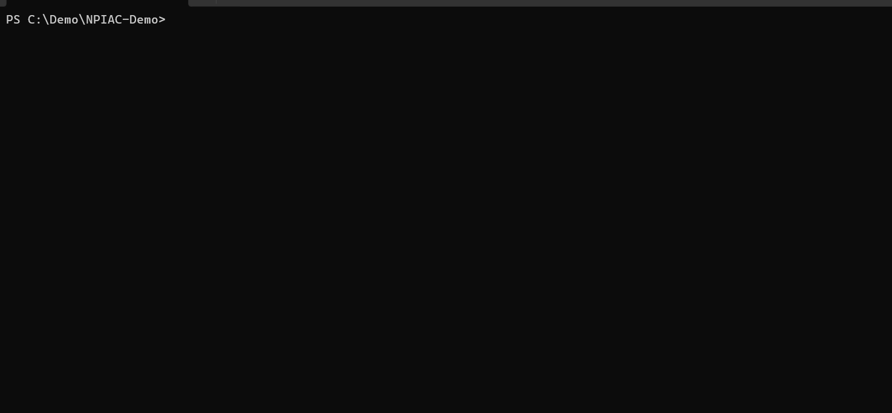

# NPIAC

[](https://github.com/dRafaleD/NPIAC/actions/workflows/tests.yml)

[](LICENSE)



**Not Prompt, It’s Also Context.**

NPIAC turns a local software repository into a compact, deterministic `CONTEXT.md` briefing for coding agents.

```bash
npiac .
```

produces:

```text
CONTEXT.md
```

The file summarizes repository structure, technologies, important files, entry points, tests, and configuration before an agent starts working.

> **AI is not required.** NPIAC works deterministically on its own and can optionally add local architecture guidance through Ollama.

## Why NPIAC?

Coding agents often begin by rediscovering how a repository is organized. NPIAC creates a reusable project briefing first, giving the agent structured context without depending on a hosted model or cloud service.

## What NPIAC detects

NPIAC follows a simple high-level flow:

```text
repository → deterministic analysis → AI-ready context
```

It detects and summarizes:

- programming languages and supported frameworks;
- manifests, package managers, and build tools;
- repository and multi-component workspace structure;
- important production files and selection reasons;
- probable application entry points;
- tests, configuration, database, and infrastructure signals.

## Installation

NPIAC 0.6.0 requires Python 3.11 or newer and has no required runtime dependencies.

Install the current source release:

```bash
git clone https://github.com/dRafaleD/NPIAC.git
cd NPIAC
python -m pip install .
```

PyPI installation will be documented after the package is actually published. No PyPI release is claimed yet.

## Quick start

Generate deterministic context in the current repository:

```bash
npiac .
```

Useful variations:

```bash
# Print Markdown without writing a file
npiac . --stdout

# Choose another output path
npiac . --output docs/PROJECT_CONTEXT.md

# Limit the final context size
npiac . --budget 20000

# Add optional local Ollama enrichment
npiac . --ai --provider ollama --model qwen3:14b
```

## Deterministic mode

```bash
npiac .
```

This mode requires no model, API key, cloud account, or network connection. NPIAC scans, detects, ranks, and renders using local deterministic heuristics. Repeated runs against unchanged inputs produce unchanged output.

## Optional local AI enrichment

```bash
npiac . --ai --provider ollama --model qwen3:14b
```

Ollama is optional and defaults to the local endpoint at `http://localhost:11434`. The requested model must already be available to Ollama. Larger capable coding models may provide richer architectural summaries, but NPIAC does not guarantee model-specific output quality.

AI enrichment runs after deterministic analysis and can add only project purpose, architecture, component, relationship, and coding-agent notes. If Ollama is unavailable or validation fails, deterministic generation still succeeds with a warning.

> Deterministic analysis remains the source of truth.

## Example output

```markdown
<!-- Generated by NPIAC; do not edit. -->
# Repository Context

## Overview

- Project name: sample-api
- Repository type: Git
- Languages: Python

## Technologies

### Frameworks and libraries

- FastAPI

## Important Files

- `pyproject.toml` — Python project manifest
- `src/sample/main.py` — Probable entry point

## Entry Points

- CLI `sample-api`: `src/sample/main.py`

## AI Enrichment

Architecture and coding-agent guidance appears here only when enrichment succeeds.
```

## Context budget

```bash
npiac . --budget 20000
```

The budget is a maximum character count. When it is exceeded, NPIAC deterministically trims lower-priority content first while preserving manifests, entry points, and high-value files where the requested size allows.

## Ignore rules

Create `.npiacignore` in the repository root:

```gitignore
docs/generated/
*.snapshot
!important.snapshot
```

Rules are ordered and support comments, globs, directory patterns ending in `/`, and `!` negation. The legacy `.repocontextignore` filename remains supported temporarily and is evaluated before `.npiacignore`.

Sensitive-file exclusions always take precedence over negation rules. NPIAC stops safely if an ignore file exists but cannot be read or validated.

## Supported ecosystems

- Python: `pyproject.toml`, `requirements.txt`, FastAPI, Flask, Django
- JavaScript and TypeScript: `package.json`, React, Next.js, Express, Vite
- Rust: `Cargo.toml`, Tokio, Axum
- .NET/C#: `.csproj`, `.sln`, ASP.NET Core, Entity Framework Core
- Generic Git and filesystem repositories
- Common monorepo and multi-application workspace layouts

Detection is heuristic and manifest-driven. NPIAC does not perform AST analysis in this release.

## Privacy and local-first behavior

- Deterministic analysis runs locally and requires no cloud service.
- Optional Ollama enrichment is sent only to the configured Ollama endpoint, which defaults to localhost.
- Safe excerpts are bounded per file and across the complete prompt.
- Secret-like files, credentials, private keys, lockfile contents, ignored paths, binaries, unsafe symlinks, and generated NPIAC output are excluded from AI input according to the current safeguards.
- Output files must remain inside the selected repository; symlinked output paths, sensitive filenames, and version-control metadata are rejected even with `--force`.
- Ollama redirects are not followed, credential-bearing base URLs are rejected, and AI debug diagnostics are bounded and redacted.

These safeguards reduce accidental disclosure but do not replace repository access controls or a dedicated secret scanner. Review generated context before sharing it outside your trust boundary.

## How it works

```text
scan
  ↓
detect
  ↓
select
  ↓
model
  ↓
optional AI enrichment
  ↓
render
```

See [Architecture](docs/ARCHITECTURE.md) for module responsibilities and safety boundaries.

## CLI reference

| Option | Purpose |
| --- | --- |
| `[PATH]` | Repository to analyze; defaults to the current directory |
| `--output FILE` | Output path relative to the repository; defaults to `CONTEXT.md` |
| `--stdout` | Print Markdown instead of writing a file |
| `--force` | Explicitly overwrite a non-NPIAC output file |
| `--budget N` | Limit final Markdown to `N` characters |
| `--ai` | Enable optional Ollama enrichment |
| `--model MODEL` | Select the local Ollama model |
| `--ollama-base-url URL` | Select the Ollama endpoint |
| `--debug-ai` | Print redacted enrichment diagnostics to standard error |

## Legacy compatibility

The deprecated command remains available during the beta transition:

```bash
repocontext .
```

It runs the same CLI and prints a warning directing users to `npiac`. New scripts should use `npiac`.

## Documentation

- [Quick start](docs/QUICKSTART.md)
- [Architecture](docs/ARCHITECTURE.md)
- [Release notes](RELEASE_NOTES.md)
- [Changelog](CHANGELOG.md)
- [Contributing](CONTRIBUTING.md)
- [Security policy](SECURITY.md)

## Status

**v0.6.0 Public Beta**

NPIAC is ready for early public use, but CLI details and generated output may still evolve before v1.0. It is not presented as production-stable software.

## Contributing

Focused issues and pull requests are welcome. See [CONTRIBUTING.md](CONTRIBUTING.md) for setup, tests, and review expectations.

## Security

Report vulnerabilities privately through the process in [SECURITY.md](SECURITY.md).

## License

NPIAC is available under the [MIT License](LICENSE).
